<div align="center">


<a href="https://statbet-g0hj.onrender.com/moderador"></a>

<p>


<br/>


</p>

<a href="https://statbet-g0hj.onrender.com/moderador"></a>
&nbsp;
<a href="https://render.com/deploy?repo=https://github.com/mariazabache0510-ctrl/StatBet"></a>

</div>

<br/>

StatBet es una actividad de evaluación en tiempo real para la clase de **Análisis Cuantitativo de Datos**. Cada estudiante entra desde su celular con 100 fichas y, ronda a ronda, ve una afirmación estadística: tiene que decidir si es verdadera o falsa y cuántas fichas arriesga según qué tan seguro está. Si acierta, gana lo apostado; si falla, lo pierde.

La idea de fondo es medir algo que un examen tradicional no ve: **si el estudiante sabe lo que sabe**. Quien apuesta todo y falla deja ver un error de concepto; quien acierta pero apostó poco todavía tiene dudas. Por eso la nota final combina los aciertos con la calibración de la confianza, y el docente recibe un informe con los conceptos en los que el curso apostó seguro y se equivocó.

<p align="center">
  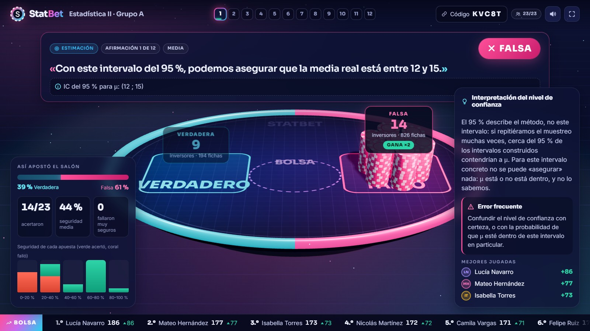
  <br/><sub>El proyector al revelar una afirmación: la bolsa se reparte entre Verdadero y Falso, el banco paga a los ganadores y a los lados aparecen la explicación y el error frecuente.</sub>
</p>

## Contenido

- [Cómo se juega](#cómo-se-juega)
- [Qué se evalúa](#qué-se-evalúa)
- [Capturas](#capturas)
- [Funcionalidades](#funcionalidades)
- [Tecnologías](#tecnologías)
- [Arquitectura](#arquitectura)
- [Ejecutar en local](#ejecutar-en-local)
- [Despliegue](#despliegue)
- [El banco de afirmaciones](#el-banco-de-afirmaciones)
- [Estructura del proyecto](#estructura-del-proyecto)

## Cómo se juega

| | |
|---|---|
| **1. Entrar** | El docente proyecta la sala. Los estudiantes escanean el QR, escriben su nombre y reciben 100 fichas. |
| **2. Apostar** | Aparece una afirmación, por ejemplo *«Un R² de 0,81 prueba que estudiar más causa mejores notas»*. Cada quien elige Verdadera o Falsa y mueve el control de fichas: apostar poco es decir «no estoy seguro», apostar todo es decir «estoy 100 % seguro». |
| **3. Revelar** | Se cierran las apuestas y el proyector muestra cómo apostó el salón, la respuesta correcta, la explicación y el error de concepto que la afirmación busca destapar. |
| **4. Cerrar** | Tras rotar por los cuatro temas, el proyector muestra si el salón «sabe lo que sabe» y revela el podio. Cada estudiante ve su nota y su mapa de confianza en el celular. |

## Qué se evalúa

Cada apuesta se traduce en una probabilidad declarada. Si un estudiante arriesga la fracción `c` de sus fichas, está diciendo que cree acertar con probabilidad `p = 0,5 + 0,5·c`. Con eso se calcula la **puntuación de Brier** de la ronda, `s = 1 − (o − p)²`, donde `o` vale 1 si acertó y 0 si no.

La nota (de 0 a 5) pondera dos partes, con pesos que el docente puede ajustar:

```
Nota = 0,6 × aciertos (0–5) + 0,4 × calibración (0–5)
```

Brier es una regla de puntuación *propia*: la estrategia que da mejor resultado esperado es apostar exactamente según la seguridad real. Ni ir siempre con todo ni apostar siempre lo mínimo funciona, y hay pruebas automáticas que lo verifican.

Cada apuesta además cae en uno de cuatro cuadrantes:

| | Apostó poco | Apostó fuerte |
|---|---|---|
| **Acertó** | Duda: sabe, pero todavía duda | Dominio: sabe que sabe |
| **Falló** | Prudencia: sabe que no sabe | **Error de concepto**: cree saber algo que no es así |

El informe del docente ordena las afirmaciones por **índice de riesgo**, la confianza promedio que se perdió en cada una. Arriba quedan los errores más graves: los que el curso cometió convencido de tener la razón.

## Capturas

<table>
<tr>
<td width="50%">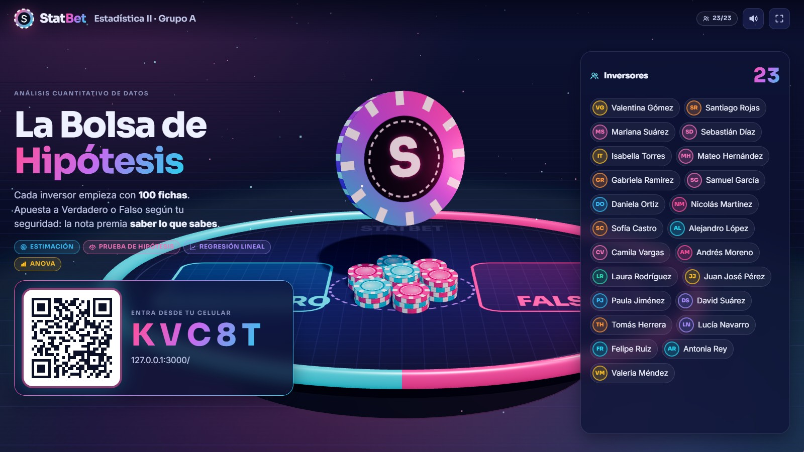<br/><sub><b>Sala de espera.</b> QR, código y la lista de quienes van entrando.</sub></td>
<td width="50%">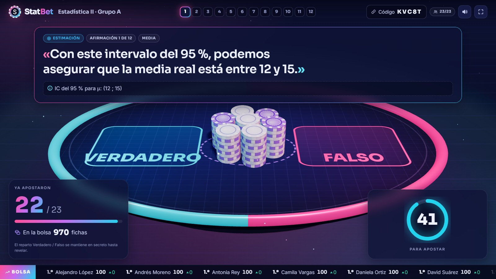<br/><sub><b>Apuestas abiertas.</b> Las fichas caen a la bolsa sin revelar hacia qué lado van.</sub></td>
</tr>
<tr>
<td>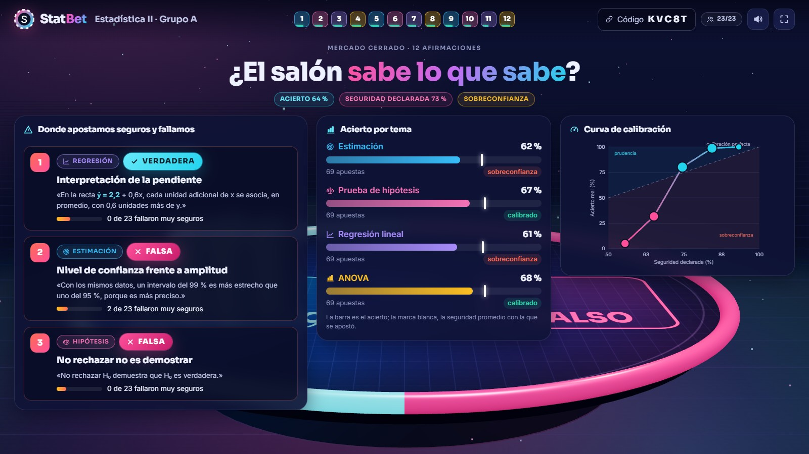<br/><sub><b>Cierre.</b> Conceptos críticos, acierto por tema y curva de calibración del curso.</sub></td>
<td>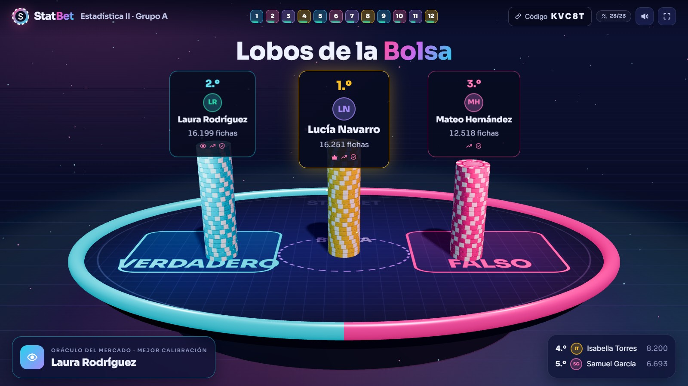<br/><sub><b>Podio.</b> Torres de fichas para los tres primeros y el premio a la mejor calibración.</sub></td>
</tr>
</table>

<table>
<tr>
<td width="33%" align="center">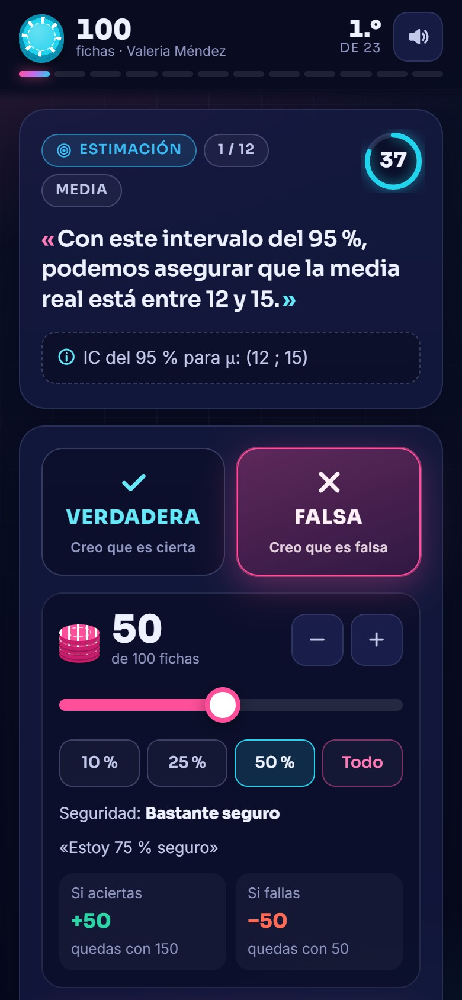<br/><sub><b>Apostar.</b> Lado, fichas y cuánto se gana o se pierde.</sub></td>
<td width="33%" align="center">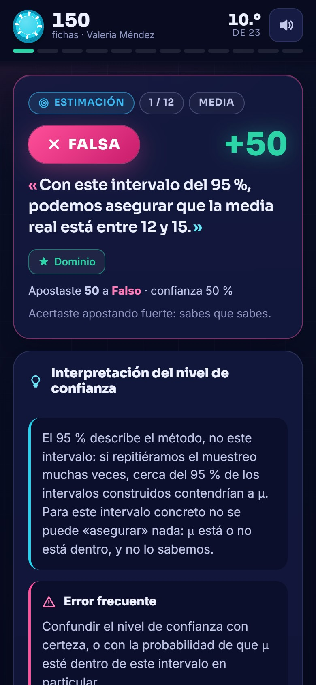<br/><sub><b>Revelación.</b> Resultado, cuadrante y explicación.</sub></td>
<td width="33%" align="center">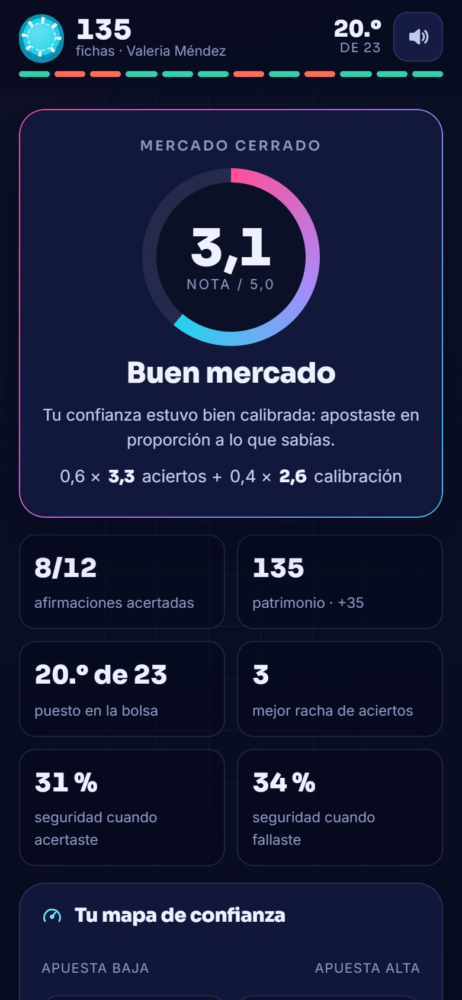<br/><sub><b>Final.</b> Nota, calibración y mapa de confianza.</sub></td>
</tr>
</table>

<table>
<tr>
<td width="50%">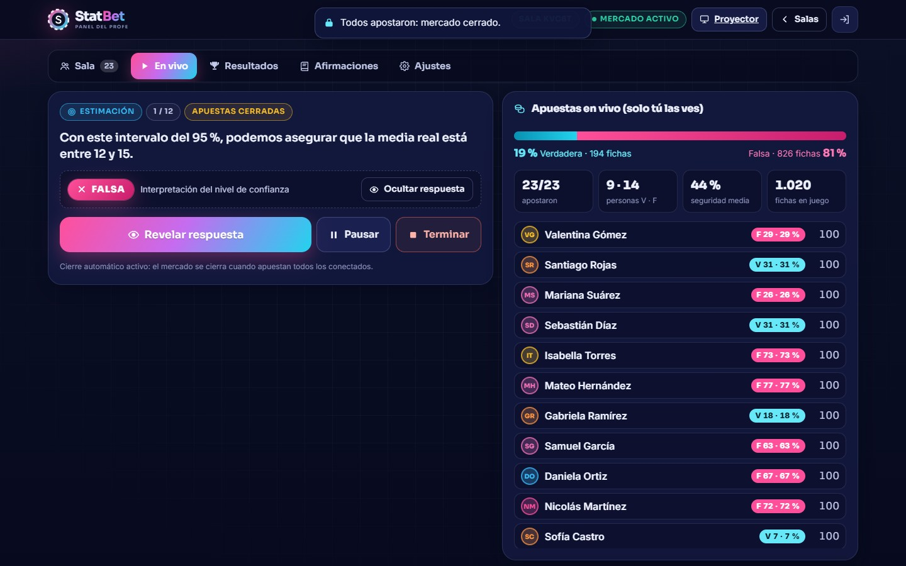<br/><sub><b>Panel del docente.</b> Control de la ronda y apuestas en vivo (solo el docente ve el reparto).</sub></td>
<td width="50%">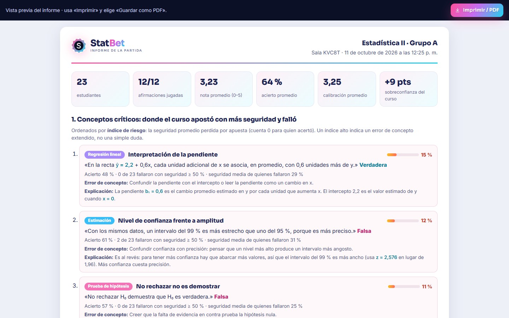<br/><sub><b>Informe.</b> Listo para imprimir o guardar como PDF.</sub></td>
</tr>
</table>

## Funcionalidades

**Para el estudiante (celular)**
- Ingreso con QR o código, sin cuentas ni contraseñas. Si recarga la página, vuelve a la partida con sus fichas y su apuesta.
- Control de apuesta con atajos (10 %, 25 %, 50 %, todo) y una vista previa de lo que gana o pierde.
- Después de cada ronda: resultado, cuadrante, explicación y cómo apostó el resto del salón.
- Pantalla final con nota, desglose de la fórmula, insignias, mapa de confianza y repaso de cada apuesta.
- Si se queda sin fichas, el banco le presta para que siga jugando (el préstamo se descuenta del ranking).

**Para el proyector**
- Mesa 3D con fichas que caen a la bolsa, se reparten al revelar y se apilan en el podio.
- Ranking en forma de cinta bursátil, contador de tiempo, sonidos y modo pantalla completa.
- Las notas nunca se proyectan: en pantalla solo aparece el juego.

**Para el docente**
- Varias salas a la vez, control total de la ronda (cerrar, sumar tiempo, pausar, revelar, avanzar) y modo «spoiler» que muestra la respuesta solo en su pantalla.
- Ajustes de partida: afirmaciones por tema, segundos por ronda, fichas iniciales, apuesta mínima, rescate y pesos de la nota con vista previa de escenarios.
- Editor del banco de afirmaciones con búsqueda, importación y exportación en JSON.
- Exportación a Excel y CSV, e informe imprimible con conceptos críticos, resultados por tema, curva de calibración y notas.

## Tecnologías

| Capa | Herramientas | Para qué |
|---|---|---|
| Servidor |   | API HTTP, exportaciones y archivos estáticos |
| Tiempo real |  | Canales separados por rol: estudiante, proyector y docente |
| Interfaz |    | Preact + htm con módulos ES nativos, sin paso de compilación |
| 3D |  | Mesa, fichas instanciadas y cámara del proyector |
| Persistencia |  | Salas y banco con ioredis; en local, archivos JSON |
| Reportes |  | Libro de Excel con resultados, conceptos y apuestas |
| Pruebas |  | Puntuación, motor de rondas, reporte y exportaciones |
| Despliegue |  | Blueprint con servicio web y Key Value |

## Arquitectura

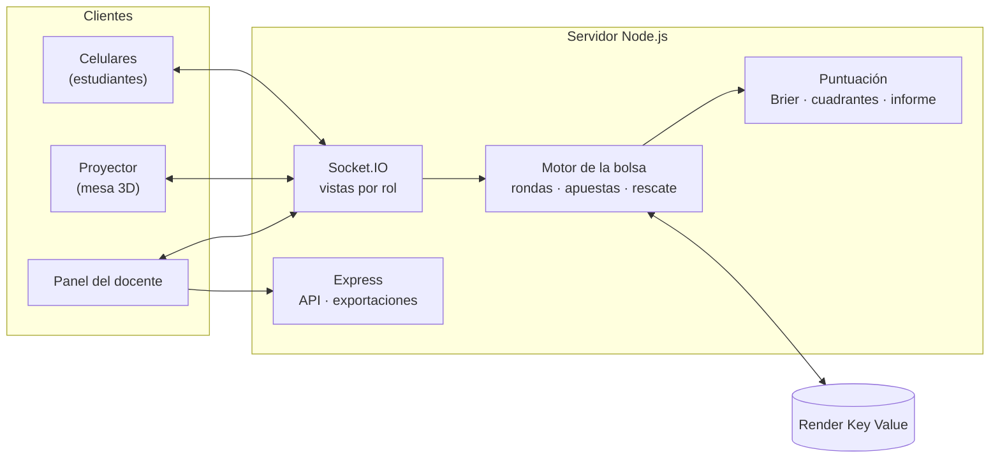

El servidor es la única fuente de verdad. La respuesta correcta y el reparto de las apuestas no salen de él hasta que el docente revela, así que nadie puede adivinar la respuesta mirando el tráfico del navegador. Cada rol recibe su propia vista del estado, y las apuestas se validan en el servidor (ronda abierta, apuesta mínima y saldo disponible).

Las decisiones de diseño y su justificación están en [`docs/DECISIONES.md`](docs/DECISIONES.md).

## Ejecutar en local

Requiere **Node.js 20 o superior**.

```bash
npm install
npm run dev
```

Abre <http://localhost:3000/moderador> e ingresa con la clave `profe123` (solo en desarrollo). Desde el panel se crea la sala y se abre el proyector.

Para probar con celulares en la misma red Wi-Fi, abre el panel usando la IP del computador (por ejemplo `http://192.168.1.40:3000/moderador`) para que el QR apunte a una dirección alcanzable, y permite a Node en el firewall de Windows si lo pregunta.

<details>
<summary><b>Variables de entorno</b></summary>
<br/>

Todas son opcionales en local. En producción solo `MODERATOR_KEY` es obligatoria. Hay una plantilla en [`.env.example`](.env.example).

| Variable | Uso | Por defecto |
|---|---|---|
| `MODERATOR_KEY` | Clave del panel del docente | `profe123` en desarrollo |
| `PORT` | Puerto HTTP | `3000` |
| `REDIS_URL` | Conexión a Render Key Value | vacío: archivos en `.data/` |
| `PUBLIC_URL` | Dirección del QR y del enlace de ingreso | En Render, `RENDER_EXTERNAL_URL` |
| `ROOM_TTL_HOURS` | Horas que se conserva una sala inactiva | `12` |
| `STATEMENTS_FILE` | Banco de afirmaciones inicial | `data/statements.json` |
| `MAX_PLAYERS_PER_ROOM` | Tope de jugadores por sala | `80` |

</details>

<details>
<summary><b>Pruebas y herramientas</b></summary>
<br/>

```bash
npm test                      # 27 pruebas con node:test
npm run validate:statements   # revisa data/statements.json
npm run load-test             # 25 bots juegan una partida completa contra el servidor
```

La prueba de carga acepta `--bots 60`, `--pace 1`, `--hold` (une los bots y deja que el docente conduzca desde el panel), `--code ABC12` (une bots a una sala existente) y `--url` / `--key` para probar contra el servidor desplegado. Al final muestra la latencia de las apuestas y el podio.

</details>

<details>
<summary><b>Guía rápida para el día de la clase</b></summary>
<br/>

1. Abre el panel unos minutos antes (en el plan gratuito de Render el servicio tarda en despertar). Revisa en **Ajustes** cuántas afirmaciones por tema habrá: con 3, la partida tiene 12 rondas y dura unos 15 minutos.
2. Proyecta la sala y explica la regla clave: apostar poco es «no estoy seguro», apostar todo es «estoy seguro».
3. En la pestaña **En vivo** conduces cada ronda. Se cierra sola cuando se acaba el tiempo o cuando todos apostaron.
4. Al terminar, muestra el cierre del mercado, comenta los conceptos críticos y revela el podio.
5. En **Resultados** descargas el Excel o abres el informe para guardarlo en PDF.

</details>

## Despliegue

El repositorio incluye un Blueprint de Render ([`render.yaml`](render.yaml)) con un servicio web y una instancia de Key Value, ambos en plan gratuito. Basta con usar el botón **Desplegar en Render** de arriba o crear un Blueprint desde el dashboard; Render pedirá la `MODERATOR_KEY`.

El Key Value guarda las salas y el banco aunque el servicio se reinicie. El plan gratuito del servicio web se suspende tras 15 minutos sin tráfico, así que conviene abrir el panel antes de la clase.

## El banco de afirmaciones

El banco inicial tiene 28 afirmaciones (7 por tema) en [`data/statements.json`](data/statements.json). Cada una trae la respuesta, el concepto que evalúa, una explicación y el error de concepto que delata:

```json
{
  "id": "EST-1",
  "topic": 1,
  "truth": false,
  "difficulty": "media",
  "statement": "Con este intervalo del 95 %, podemos asegurar que la media real está entre 12 y 15.",
  "data": "IC del 95 % para μ: (12 ; 15)",
  "concept": "Interpretación del nivel de confianza",
  "explanation": "El 95 % describe el método, no este intervalo…",
  "misconception": "Confundir el nivel de confianza con certeza…"
}
```

Los temas son `1` Estimación, `2` Prueba de hipótesis, `3` Regresión lineal y `4` ANOVA, y las rondas se intercalan entre ellos. Desde el panel se pueden editar, agregar o desactivar afirmaciones; esos cambios se guardan en la persistencia sin tocar el archivo.

## Estructura del proyecto

```
src/
  app.js, server.js, config.js     servidor HTTP, Socket.IO y configuración
  modules/
    market/                        motor de rondas: abrir, apostar, cerrar, revelar, rescate
    scoring/                       Brier, nota, cuadrantes, insignias e informe del curso
    realtime/                      vistas por rol y eventos en tiempo real
    rooms/  statements/            salas, jugadores y banco de afirmaciones
    persistence/  exports/         Key Value o archivos; CSV, Excel y JSON
public/
  js/views/                        estudiante, proyector, panel, editor del banco, informe
  js/components/market3d.js        escena 3D del proyector
  css/                             sistema visual
data/statements.json               banco inicial
scripts/                           validación del banco y prueba de carga
tests/                             pruebas con node:test
```

<br/>

<div align="center">

Desarrollado por **[Mariana Azabache](https://www.linkedin.com/in/mariana-azabache-b1334b371/)** · Tecnología en Desarrollo de Software, UNIMINUTO


</div>
